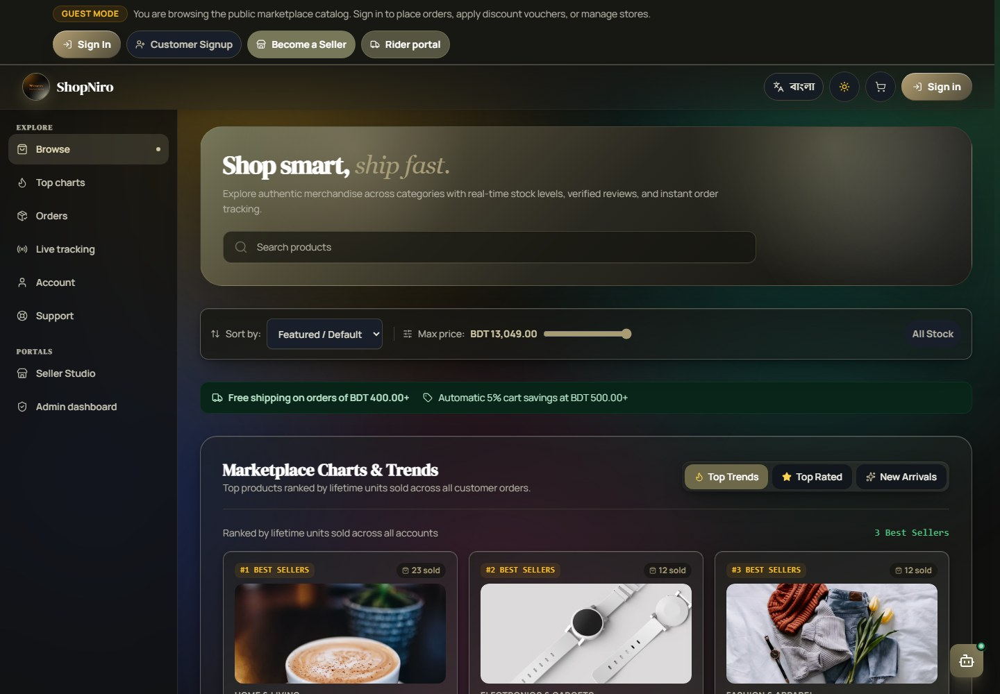
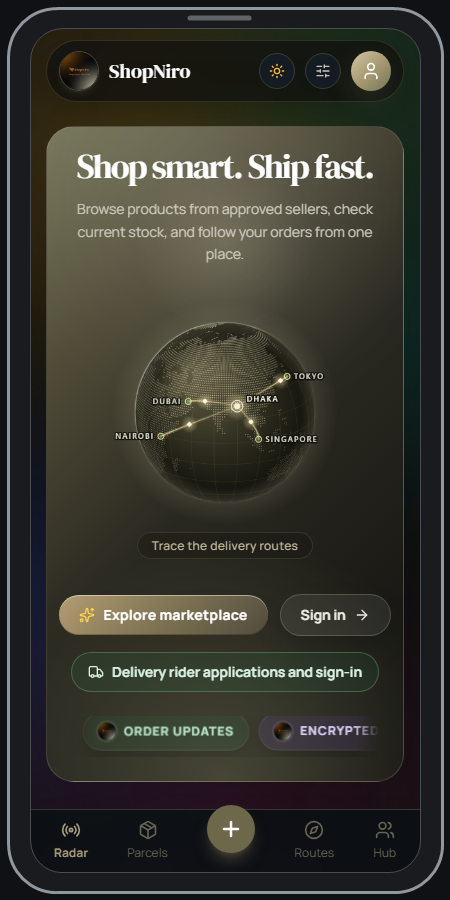
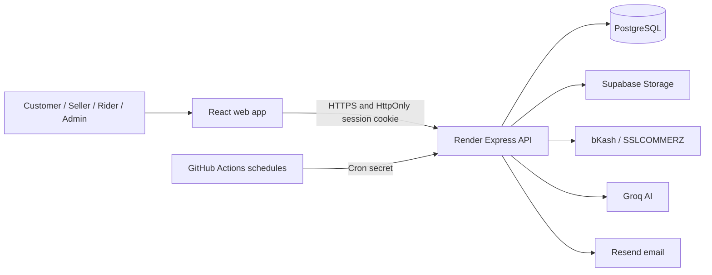

<div align="center">


# ShopNiro

**Shop smart. Ship fast.**

A multi-vendor marketplace for Bangladesh, connecting shoppers, sellers,
admins, and delivery riders in one order journey.

[](https://github.com/Kairo-2081/ShopNiro/actions/workflows/ci.yml)
[](./LICENSE)

[Live marketplace](https://shopniro.onrender.com/) ·
[Android APK](https://github.com/Kairo-2081/ShopNiro/releases/latest/download/ShopNiro.apk) ·
[API docs](./docs/api.md) ·
[Deployment guide](./README-DEPLOY.md)


</div>

**On this page:** [Try it](#try-it) · [Product tour](#product-tour) ·
[How it works](#how-it-works) · [Engineering](#engineering) ·
[Get started](#get-started) · [Project status](#project-status-and-next-steps)

ShopNiro brings product discovery, seller approval, local payment options,
order updates, and last-mile delivery into one marketplace. Customers can shop
from multiple sellers; approved sellers manage their stores; admins oversee
marketplace operations; and riders update assigned deliveries.

## Try it

| Role | What you can try |
| --- | --- |
| Customer | Browse the public catalog without signing in. An account is required to place an order. |
| Seller | Apply through seller signup. An admin must approve the application before the store can operate. |
| Rider | Apply through the rider portal. An admin must approve the application before delivery work is available. |
| Admin | Public admin signup is disabled; admin access is not shared. |

No shared seller or rider demo accounts are published. The public deployment
is not documented as a sandbox, so do not submit payment details there. Local
development and CI use a payment simulator that does not contact a real gateway.

## Product tour

The images below are real captures of the public interface. The registration
capture shows all three account choices together; the other two signup captures
are intentionally omitted.

[Watch the 65-second public-site recording](./.github/assets/readme/shopniro-public-tour.webm)
(WebM, 1280 × 720). It shows browsing, search, a product detail, and the signup
role selector; it does not show sign-in, checkout, payment, or rider delivery.

<div align="center">

<table>
<tr>
<td width="50%" valign="top">

<p><b>Browse the catalog.</b> Search listings, compare prices, and check stock before ordering.</p>
</td>
<td width="50%" valign="top">

<p><b>Explore what is selling.</b> Product rankings and category trends bring popular listings into view.</p>
</td>
</tr>
<tr>
<td width="50%" valign="top">

<p><b>Review the details.</b> Product pages show listing information, seller details, and policies.</p>
</td>
<td width="50%" valign="top">

<p><b>Choose an account type.</b> Customer, seller, and rider registration start in the same flow.</p>
</td>
</tr>
</table>

<p>

</p>
<p><b>Mobile storefront.</b> Captured from the public site at a narrow viewport; the Android wrapper uses the app's web interface.</p>

</div>

Authenticated seller, admin, assistant, checkout, tracking, and rider screens
are not pictured yet. They need to be captured from seeded staging data, not
production customer accounts.

## How it works

1. A customer finds an in-stock product from an approved seller and adds it to
   the cart.
2. At checkout, the customer confirms the order and selects an available
   payment method.
3. The seller processes the order and updates its status.
4. The customer follows delivery updates; an assigned rider records delivery
   progress and cash-on-delivery collection.

The browser journey is exercised in
[`e2e/marketplace-flow.spec.ts`](./e2e/marketplace-flow.spec.ts).

## Evidence from CI

| Measure | Result |
| --- | --- |
| Node test-runner cases | 271 in the [12 Nov 2026 CI run](https://github.com/Kairo-2081/ShopNiro/actions/runs/43311782295) |
| Lighthouse accessibility | 100/100 on the mobile accessibility audit in that CI run |
| Database migrations | 12 numbered PostgreSQL migrations |

The Playwright accessibility suite also runs axe checks; axe reports rule
violations rather than a single score. Payment benchmark instructions are in
[`docs/benchmarks.md`](./docs/benchmarks.md). They use a stub gateway and local
PostgreSQL, so their latency numbers are not production measurements.

## Engineering

### Technology

| Layer | Technology |
| --- | --- |
| Web app | React, Vite, TypeScript |
| API | Node.js, Express, TypeScript |
| Database | PostgreSQL |
| File storage | Supabase Storage for product images and private seller documents |
| Authentication | App-issued JWT in an HttpOnly cookie; server-side session revocation |
| Payments | bKash, SSLCOMMERZ, and cash on delivery |
| AI | Groq API for product discovery assistance |
| Testing | Node.js test runner, Playwright, axe, and Lighthouse |
| Mobile / desktop | Capacitor for Android; Electron for desktop |
| Hosting | Render for the Express API; Vercel can host the static frontend |
| CI | GitHub Actions with PostgreSQL 16 |

### Decisions and trade-offs

- **Revocable cookie sessions.** Session tokens stay in an HttpOnly cookie, and
  token IDs are persisted so logout can revoke them before expiry. Production
  cross-site cookies require `SameSite=None`; cookie-authenticated writes
  therefore also require an allowed `Origin` or `Referer`. Frontend origins
  must stay in sync with the API allowlist.
- **Deny-by-default API.** Only explicitly listed method/path pairs are public,
  which reduces accidental exposure. Adding a public route requires updating
  the allowlist and its policy tests.
- **Idempotent payment handling.** Pending payments are reused and finalization
  is transactional, protecting against callback retries and duplicate orders.
  The cost is extra database coordination; duplicate successful payments still
  need a refund workflow.
- **Private seller documents.** Verification files use signed access through a
  private storage bucket. This protects documents but makes seller review
  depend on the storage provider being available.
- **External scheduled jobs.** GitHub Actions calls protected cron endpoints
  outside the web process. This keeps jobs independent of server
  uptime, but hosted schedules can slip; handlers must tolerate delayed and
  repeated calls.
- **Data export and deletion.** Customers can request either, while payment,
  order, and consent records may need to be retained. Automated cleanup remains
  off until legal and accounting requirements are confirmed.

### Architecture



## Get started

### Requirements

- Node.js 22
- Docker Desktop with Compose, or PostgreSQL 16 already running locally

### Install

```sh
git clone https://github.com/Kairo-2081/ShopNiro.git
cd ShopNiro
npm ci
```

To start a local PostgreSQL 16 database with Docker Compose:

```sh
docker compose up -d db
```

Copy `.env.example` to `.env` (`Copy-Item .env.example .env` in PowerShell).
The example is preconfigured for the local Compose database. Set
`NODE_ENV=development` and replace `JWT_SECRET` with a unique random value of
at least 32 characters. Generate one with:

```sh
node -e "console.log(require('node:crypto').randomBytes(64).toString('hex'))"
```

Apply migrations and start the app:

```sh
npm run migrate
npm run dev
```

The app starts at `http://localhost:3000` by default. To seed a fresh
development database, set `SEED_ON_START=true` and provide unique
`SHOPNIRO_SEED_ADMIN_PASSWORD`, `SHOPNIRO_SEED_SELLER_PASSWORD`, and
`SHOPNIRO_SEED_CUSTOMER_PASSWORD` values (at least 16 characters each).
Seeding is disabled by default and must never be enabled in production.

Never commit `.env` or use development credentials in production. Do not point
tests at production or shared customer data.

### Environment variables

| Variable(s) | When needed | Purpose |
| --- | --- | --- |
| `NODE_ENV` | Always | Set explicitly to `development`, `test`, or `production`. |
| `DATABASE_URL` | Always | PostgreSQL connection for the API. |
| `JWT_SECRET` | Always | Signs session tokens; minimum 32 characters. |
| `CRON_SECRET` | Production and scheduled jobs | Authorizes protected scheduler requests. |
| `SSLCOMMERZ_STORE_ID`, `SSLCOMMERZ_STORE_PASSWORD`, `SSLCOMMERZ_IPN_TOKEN` | Production online payments | Gateway credentials and callback verification. |
| `SSLCOMMERZ_IS_SANDBOX` | Production online payments | Must be `false` with live credentials. |
| `SUPABASE_URL`, `SUPABASE_SERVICE_ROLE_KEY` | Storage features | Server-side storage access; never expose the service-role key to the browser. |
| `GROQ_API_KEY` | AI features | Enables the AI assistant and AI-assisted tools. |
| `RESEND_API_KEY`, `SHOPNIRO_FROM_EMAIL`, `SHOPNIRO_PUBLIC_URL` | Email delivery | Enables welcome and password-recovery emails; configure a verified sender. |
| `SHOPNIRO_SUPPORT_EMAIL` | Optional | Support-request notification recipient. |
| `VITE_API_URL` | Separate frontend hosting | API origin used by the browser build. |
| `ONLINE_PAYMENTS_ENABLED` | Optional | Set to `false` to disable new online payment sessions while keeping cash on delivery available. |

This is a summary, not the complete configuration. See
[`.env.example`](./.env.example) and the
[deployment guide](./README-DEPLOY.md). The payment simulator is restricted to
development and test environments.

### Tests

Use an isolated, disposable PostgreSQL database and apply migrations before
running database-backed tests.

```sh
npm test
npm run lint
npm run build
npm run e2e
npm run test:a11y -- --project=desktop
```

CI provisions a temporary PostgreSQL 16 database and runs validation, browser,
and accessibility checks. Browser tests use the built-in payment simulator,
not a real gateway. Payment latency and idempotency benchmarks are available
with `npm run bench:payments`; see [`docs/benchmarks.md`](./docs/benchmarks.md).

### Scheduled jobs

- GitHub Actions calls `/api/cron/expire-orders` and `/api/cron/refunds` every
  five minutes and `/api/riders/payroll/settle` daily.
- A separate nightly GitHub Actions workflow calls
  `/api/cron/reconcile-payments`.

Configure the GitHub Actions secrets `APP_URL` (the API origin) and
`CRON_SECRET`. Hosted scheduler runs may be delayed; use a host-provided
scheduler when timing is important.

### Project guides

- [API routes](./docs/api.md)
- [Database design](./docs/database-design.md) and [ER diagram](./docs/erd.md)
- [Operational flows](./docs/flows.md)
- [Seller and rider payouts](./docs/payouts.md)
- [Deployment guide](./README-DEPLOY.md)
- [Legal review and retention checklist](./docs/legal-review.md)
- [Operational runbooks](./docs/runbooks/README.md)

### Project layout

```text
src/                  React frontend
server/               Express API, middleware, and route handlers
db/migrations/        Numbered PostgreSQL migrations
docs/                 API, architecture, policies, and operational guides
e2e/                  Playwright browser tests
tests/                Unit, integration, and route-policy tests
android/              Capacitor Android project
electron/              Desktop application wrapper
scripts/               Migrations, checks, and maintenance utilities
```

## Project status and next steps

- **Legal review:** Legal copy, business disclosures, and retention decisions
  are provisional and still need qualified Bangladesh legal and accounting
  review. See the [legal review checklist](./docs/legal-review.md).
- **Evidence to add:** Capture seller orders and wallet, admin approvals, an
  assistant response to a real query, checkout options, order tracking, and
  rider delivery from seeded staging data. Record a 60–90 second order
  walkthrough from that same safe environment.
- **Demo access:** Publish customer, seller, and rider demo accounts only after
  the owner provisions and verifies them. Never publish admin credentials.
- **Operations:** Verify the staging and production payment modes and complete
  the independent deployment/rollback rehearsal in the
  [deployment guide](./docs/deployment-rehearsal.md).

### AI-tool use

AI coding tools were used for implementation and documentation assistance.
Generated suggestions were reviewed and tested; the project maintainers remain
responsible for understanding and explaining the authentication, payment, and
data-handling code.

## License

MIT. See [LICENSE](./LICENSE).
