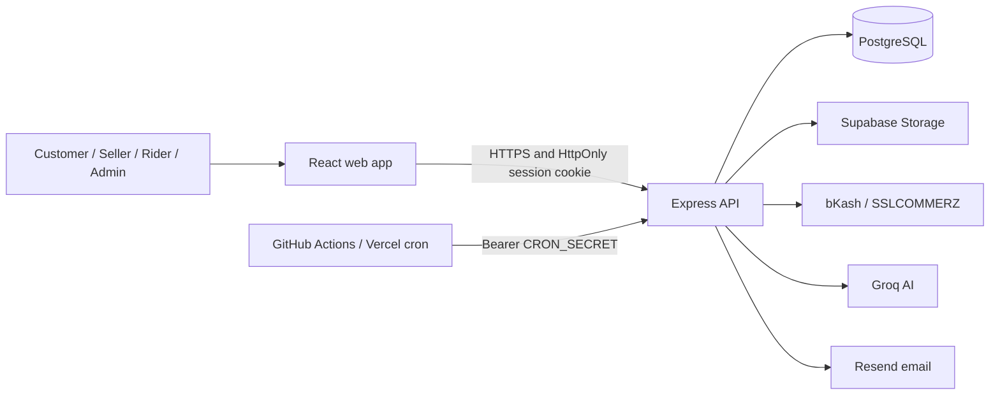

# ShopNiro

**Shop smart. Ship fast.**

A multi-vendor marketplace built for Bangladesh. Customers can shop, pay with local payment options, and track deliveries while approved sellers manage their stores.

---

## Why ShopNiro

Marketplace software often treats local payments, seller onboarding, and last-mile delivery as add-ons. ShopNiro brings those workflows together for customers, sellers, riders, and admins, with Bangladesh-focused payment and delivery options.

## Features

**For customers**

- Browse products, manage a cart, place orders, and track deliveries.
- Choose cash on delivery or an available online payment method, including bKash and SSLCOMMERZ.
- Ask the AI shopping assistant for help discovering products.
- Accept the terms at registration and checkout; consent is recorded with its policy version and timestamp.
- Request a personal-data export or account deletion.

**For sellers**

- Apply to sell; an admin must approve an application before the seller can operate.
- Manage products, inventory, orders, and store information.
- Review earnings and request payouts under the [payout policy](./docs/payouts.md).

**For riders**

- Apply to deliver and manage assigned deliveries after approval.
- Record delivery progress, cash-on-delivery collection, and wallet activity.

**For admins**

- Review seller and rider applications.
- Manage marketplace operations, payments, refunds, and seller payouts.
- Create admin accounts from an existing admin account; there is no public admin signup.

**Platform**

- Process order expiry, refunds, payment reconciliation, and rider payroll through scheduled jobs.
- Store support requests in PostgreSQL and optionally send email notifications.
- Provide Android (Capacitor) and desktop (Electron) application wrappers.

## Demo

Legal and retention decisions are provisional and still require qualified Bangladesh counsel/accountant review. See the [legal review checklist](./docs/legal-review.md).

## Tech stack

| Layer | Technology |
| --- | --- |
| Frontend | React, Vite, TypeScript |
| API | Node.js, Express, TypeScript |
| Database | PostgreSQL |
| File storage | Supabase Storage (private seller-document bucket; public product-image bucket) |
| Authentication | App-issued JWT in an HttpOnly cookie; server-side session revocation |
| Payments | bKash, SSLCOMMERZ, and cash on delivery |
| AI | Groq API |
| Email | Resend (optional) |
| Testing | Node.js test runner, Playwright, axe, Lighthouse |
| CI | GitHub Actions with PostgreSQL 16 |
| Deployment and schedules | Vercel/Render, GitHub Actions cron |
| Mobile / desktop | Capacitor (Android), Electron |

## Architecture

## Engineering decisions

- **Revocable sessions.** The app stores its signed JWT in an HttpOnly cookie and persists each token ID in `auth_sessions`. This keeps tokens out of browser JavaScript and lets logout revoke a session before token expiry.
- **Deny-by-default API.** API requests require authentication unless the method and path are explicitly listed in [`server/middleware/publicRoutes.ts`](./server/middleware/publicRoutes.ts). Route-policy tests guard this boundary. Public cron routes still validate their own shared secret.
- **Idempotent payment handling.** Payment initialization reuses pending payments, gateway callbacks validate transaction details, and database transactions protect finalization. Duplicate payments enter the refund flow rather than creating duplicate paid orders. See [payment and refund flows](./docs/flows.md).
- **Private seller documents.** Seller verification files use a private Supabase Storage bucket and signed access, rather than public URLs. Keep the service-role key on the server.
- **External scheduled work.** GitHub Actions and Vercel call protected cron endpoints instead of relying on a web process staying alive. Hosted schedules can be delayed; use a host-provided scheduler if a job needs tighter timing.
- **Provisional privacy handling.** Customers can export their account data and request deletion, but some order, payment, and consent records may be retained. Automated retention cleanup is disabled pending legal and accounting review; see [docs/legal-review.md](./docs/legal-review.md).
