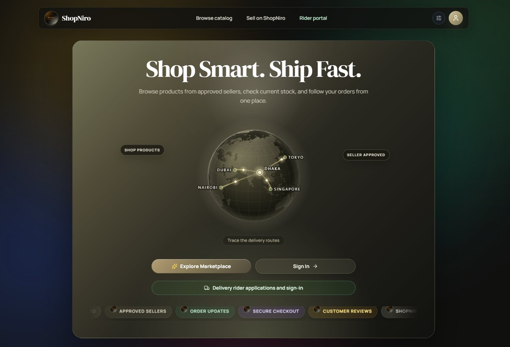
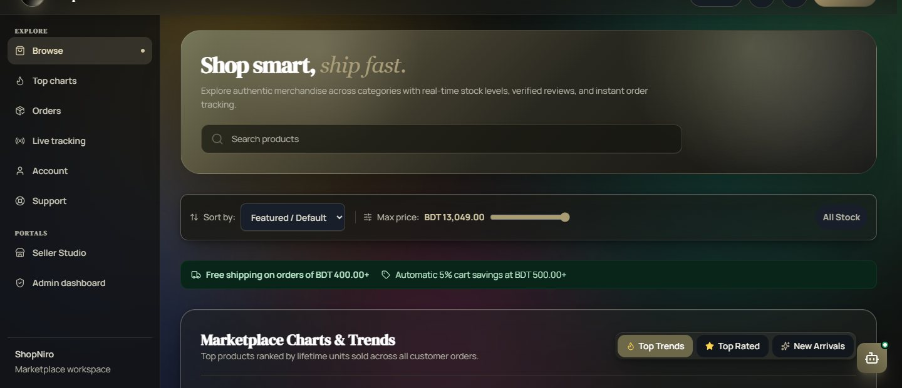
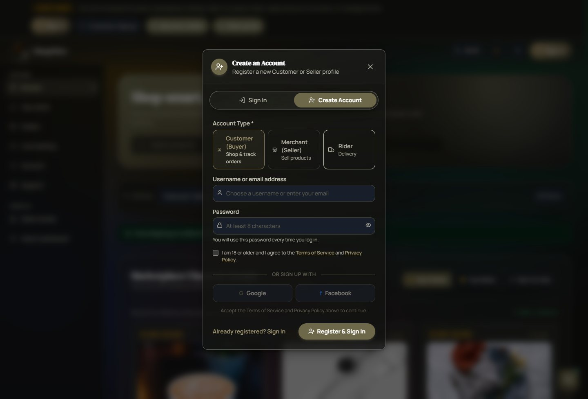
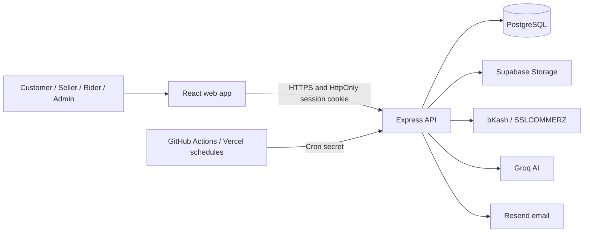

<div align="center">


# ShopNiro

**Shop smart. Ship fast.**

A multi-vendor marketplace built for Bangladesh: discover products, pay with local options, and follow deliveries while approved sellers manage their stores.

[](https://github.com/Kairo-2081/ShopNiro/actions/workflows/ci.yml)
[](./LICENSE)

<br />

[Live marketplace](https://shopniro.onrender.com/) · [API docs](./docs/api.md) · [Deployment guide](./README-DEPLOY.md) · [Issues](https://github.com/Kairo-2081/ShopNiro/issues)

<br />



</div>

ShopNiro brings the parts of online shopping that are often treated separately—seller approval, local payments, order updates, and last-mile delivery—into one marketplace. Customers can shop from multiple sellers, sellers can manage their own listings and orders, and admins oversee marketplace operations.

## One marketplace, four roles

**For shoppers**

- Browse approved listings, search and sort products, and check prices and stock before ordering.
- Pay using cash on delivery or an available online payment method, including bKash and SSLCOMMERZ.
- Follow order and delivery updates, contact support, and leave product reviews.
- Agree to the Terms of Service and Privacy Policy when creating an account; consent is recorded with its policy version and timestamp.
- Request a personal-data export or account deletion.

**For sellers**

- Apply to sell; an admin reviews the application before the store can operate.
- Manage products, inventory, customer orders, and store information.
- Review earnings and request payouts under the [payout policy](./docs/payouts.md).

**For riders**

- Apply to deliver and manage assigned deliveries after approval.
- Record delivery progress, cash-on-delivery collection, and wallet activity.

**For admins**

- Review seller and rider applications.
- Manage marketplace operations, categories, payments, refunds, and seller payouts.
- Create admin accounts from an existing admin account; public admin signup is disabled.

## A shopping journey

1. A shopper finds an in-stock product from an approved seller and adds it to the cart.
2. At checkout, the shopper confirms the order and selects an available payment method.
3. The seller processes the order and updates its status.
4. The shopper follows delivery updates and can review the product after it arrives.

<div align="center">

<table>
<tr>
<td width="50%" valign="top">

<p><b>Browse the marketplace.</b> Search, sort, filter stock, and explore current listings.</p>
</td>
<td width="50%" valign="top">

<p><b>Choose an account type.</b> Registration presents the policy consent before account creation.</p>
</td>
</tr>
</table>

</div>

## Built for local commerce

- **Payments:** cash on delivery and supported online payment integrations.
- **Seller trust:** seller applications are reviewed before their products can be listed.
- **Delivery:** customers can follow order progress, and riders have role-specific delivery workflows.
- **AI assistance:** a Groq-powered assistant helps shoppers discover products.
- **Support:** support requests are stored in PostgreSQL, with optional email notification.
- **Privacy controls:** customers can request their data and account deletion. Order, payment, and consent records may need to be retained; automated retention cleanup remains disabled pending legal and accounting review.

> **Policy review:** Legal copy, business disclosures, and retention decisions are provisional and still need qualified Bangladesh legal and accounting review. See the [legal review checklist](./docs/legal-review.md).

## Architecture



## Technology

| Layer | Technology |
| --- | --- |
| Web app | React, Vite, TypeScript |
| API | Node.js, Express, TypeScript |
| Database | PostgreSQL |
| File storage | Supabase Storage (private seller documents; product images) |
| Authentication | App-issued JWT in an HttpOnly cookie; server-side session revocation |
| Payments | bKash, SSLCOMMERZ, and cash on delivery |
| AI | Groq API |
| Email | Resend (optional) |
| Testing | Node.js test runner, Playwright, axe, Lighthouse |
| CI | GitHub Actions with PostgreSQL 16 |
| Scheduling and hosting | Render, Vercel, and GitHub Actions |
| Mobile / desktop | Capacitor (Android), Electron |

## Engineering decisions

- **Revocable sessions.** Session tokens stay in an HttpOnly cookie, and each token ID is persisted in `auth_sessions` so logout can revoke it before expiry.
- **Deny-by-default API.** Requests require authentication unless the method and path are explicitly listed in [`publicRoutes.ts`](./server/middleware/publicRoutes.ts). Route-policy tests protect this boundary; public cron endpoints still check their own shared secret.
- **Idempotent payment handling.** Payment initialization reuses pending payments, gateway callbacks validate transaction details, and database transactions protect finalization. Duplicate payments enter the refund flow rather than creating duplicate paid orders. See [payment and refund flows](./docs/flows.md).
- **Private seller documents.** Seller verification files use a private Supabase Storage bucket and signed access. The service-role key stays on the server.
- **Scheduled work outside the web process.** GitHub Actions and Vercel call protected cron endpoints. Hosted schedules can be delayed; use a host-provided scheduler if a job needs tighter timing.
- **Retention is deliberate.** Data export and account-deletion requests are supported, but some commerce records may need to remain. Cleanup is not automated until retention requirements are reviewed.

## Get started

### Prerequisites

- Node.js 22 (the version used in CI)
- PostgreSQL 16 and a database reserved for local development

### Install and configure

```sh
git clone https://github.com/Kairo-2081/ShopNiro.git
cd ShopNiro
npm ci
cp .env.example .env
```

In PowerShell, use `Copy-Item .env.example .env`. Set `NODE_ENV=development`, point `DATABASE_URL` to your local database, and configure a unique `JWT_SECRET` of at least 32 characters. Generate one with:

```sh
node -e "console.log(require('node:crypto').randomBytes(64).toString('hex'))"
```

Apply migrations and start the app:

```sh
npm run migrate
npm run dev
```

The development server starts at `http://localhost:3000` by default. To seed a fresh development database, set `SEED_ON_START=true` and provide unique `SHOPNIRO_SEED_ADMIN_PASSWORD`, `SHOPNIRO_SEED_SELLER_PASSWORD`, and `SHOPNIRO_SEED_CUSTOMER_PASSWORD` values (at least 16 characters each). Seeding is disabled by default and must never be enabled in production.

Never commit `.env` or use development credentials in production. Do not point tests at production or shared customer data.

### Common environment variables

| Variable(s) | When needed | Purpose |
| --- | --- | --- |
| `NODE_ENV` | Always | Set explicitly to `development`, `test`, or `production`. |
| `DATABASE_URL` | Always | PostgreSQL connection for the API. |
| `JWT_SECRET` | Always | Signs session tokens; minimum 32 characters. |
| `CRON_SECRET` | Production and scheduled jobs | Authorizes protected scheduler requests. |
| `SSLCOMMERZ_STORE_ID`, `SSLCOMMERZ_STORE_PASSWORD`, `SSLCOMMERZ_IPN_TOKEN` | Production online payments | Gateway credentials and callback verification. |
| `SSLCOMMERZ_IS_SANDBOX` | Production online payments | Must be `false` when using live credentials. |
| `SUPABASE_URL`, `SUPABASE_SERVICE_ROLE_KEY` | Storage features | Server-side storage access; never expose the service-role key to the browser. |
| `GROQ_API_KEY` | AI features | Enables the AI assistant and AI-assisted tools. |
| `RESEND_API_KEY`, `SHOPNIRO_FROM_EMAIL`, `SHOPNIRO_PUBLIC_URL` | Email delivery | Enables welcome and password-recovery emails; configure a verified sender. |
| `SHOPNIRO_SUPPORT_EMAIL` | Optional | Support-request notification recipient. |
| `VITE_API_URL` | Separate frontend hosting | API origin used by the browser build. |
| `ONLINE_PAYMENTS_ENABLED` | Optional | Set to `false` to disable new online payment sessions while keeping COD available. |

This is a summary, not the complete configuration. See [`.env.example`](./.env.example) and the [deployment guide](./README-DEPLOY.md). The payment simulator is restricted to development and test environments.

## Tests

Use an isolated, disposable PostgreSQL database. Apply migrations before running database-backed tests.

```sh
npm test
npm run lint
npm run build
npm run e2e
npm run test:a11y -- --project=desktop
```

CI provisions a temporary PostgreSQL 16 database and runs validation, browser, and accessibility checks. Browser tests use the built-in payment simulator, not a real gateway. Payment latency and idempotency benchmarks are available with `npm run bench:payments`; see [docs/benchmarks.md](./docs/benchmarks.md).

## Scheduled jobs

- GitHub Actions calls `/api/cron/expire-orders` and `/api/cron/refunds` every five minutes.
- A separate nightly GitHub Actions workflow calls `/api/cron/reconcile-payments`.
- Vercel calls `/api/riders/payroll/settle` daily.

Configure the GitHub Actions repository secrets `APP_URL` (the API origin) and `CRON_SECRET`. Scheduler runs may be delayed, so use a host-provided scheduler when timing is important.

## Project guides

- [API routes](./docs/api.md)
- [Database design](./docs/database-design.md) and [ER diagram](./docs/erd.md)
- [Operational flows](./docs/flows.md)
- [Seller and rider payouts](./docs/payouts.md)
- [Deployment guide](./README-DEPLOY.md)
- [Legal review and retention checklist](./docs/legal-review.md)
- [Operational runbooks](./docs/runbooks/README.md)

## Project layout

```text
src/                  React frontend
server/               Express API, middleware, and route handlers
db/migrations/        Numbered PostgreSQL migrations
docs/                 API, architecture, policies, and operational guides
e2e/                  Playwright browser tests
tests/                Unit, integration, and route-policy tests
android/              Capacitor Android project
electron/              Desktop application wrapper
scripts/               Migrations, checks, and maintenance utilities
```

## License

MIT. See [LICENSE](./LICENSE).
