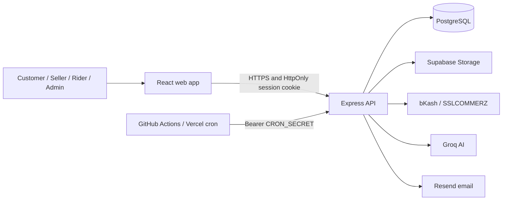

<div align="center">


# ShopNiro

**Shop smart. Ship fast.**

A multi-vendor marketplace built for Bangladesh. Customers can shop, pay with local payment options, and track deliveries while approved sellers manage their stores.

[](https://github.com/Kairo-2081/ShopNiro/actions/workflows/ci.yml)
[](./LICENSE)

</div>

---

## Why ShopNiro

Marketplace software often treats local payments, seller onboarding, and last-mile delivery as add-ons. ShopNiro brings those workflows together for customers, sellers, riders, and admins, with Bangladesh-focused payment and delivery options.

## Features

**For customers**

- Browse products, manage a cart, place orders, and track deliveries.
- Choose cash on delivery or an available online payment method, including bKash and SSLCOMMERZ.
- Ask the AI shopping assistant for help discovering products.
- Accept the terms at registration and checkout; consent is recorded with its policy version and timestamp.
- Request a personal-data export or account deletion.

**For sellers**

- Apply to sell; an admin must approve an application before the seller can operate.
- Manage products, inventory, orders, and store information.
- Review earnings and request payouts under the [payout policy](./docs/payouts.md).

**For riders**

- Apply to deliver and manage assigned deliveries after approval.
- Record delivery progress, cash-on-delivery collection, and wallet activity.

**For admins**

- Review seller and rider applications.
- Manage marketplace operations, payments, refunds, and seller payouts.
- Create admin accounts from an existing admin account; there is no public admin signup.

**Platform**

- Process order expiry, refunds, payment reconciliation, and rider payroll through scheduled jobs.
- Store support requests in PostgreSQL and optionally send email notifications.
- Provide Android (Capacitor) and desktop (Electron) application wrappers.

## Demo


Legal and retention decisions are provisional and still require qualified Bangladesh counsel/accountant review. See the [legal review checklist](./docs/legal-review.md).

## Tech stack

| Layer | Technology |
| --- | --- |
| Frontend | React, Vite, TypeScript |
| API | Node.js, Express, TypeScript |
| Database | PostgreSQL |
| File storage | Supabase Storage (private seller-document bucket; public product-image bucket) |
| Authentication | App-issued JWT in an HttpOnly cookie; server-side session revocation |
| Payments | bKash, SSLCOMMERZ, and cash on delivery |
| AI | Groq API |
| Email | Resend (optional) |
| Testing | Node.js test runner, Playwright, axe, Lighthouse |
| CI | GitHub Actions with PostgreSQL 16 |
| Deployment and schedules | Vercel/Render, GitHub Actions cron |
| Mobile / desktop | Capacitor (Android), Electron |

## Architecture



## Engineering decisions

- **Revocable sessions.** The app stores its signed JWT in an HttpOnly cookie and persists each token ID in `auth_sessions`. This keeps tokens out of browser JavaScript and lets logout revoke a session before token expiry.
- **Deny-by-default API.** API requests require authentication unless the method and path are explicitly listed in [`server/middleware/publicRoutes.ts`](./server/middleware/publicRoutes.ts). Route-policy tests guard this boundary. Public cron routes still validate their own shared secret.
- **Idempotent payment handling.** Payment initialization reuses pending payments, gateway callbacks validate transaction details, and database transactions protect finalization. Duplicate payments enter the refund flow rather than creating duplicate paid orders. See [payment and refund flows](./docs/flows.md).
- **Private seller documents.** Seller verification files use a private Supabase Storage bucket and signed access, rather than public URLs. Keep the service-role key on the server.
- **External scheduled work.** GitHub Actions and Vercel call protected cron endpoints instead of relying on a web process staying alive. Hosted schedules can be delayed; use a host-provided scheduler if a job needs tighter timing.
- **Provisional privacy handling.** Customers can export their account data and request deletion, but some order, payment, and consent records may be retained. Automated retention cleanup is disabled pending legal and accounting review; see [docs/legal-review.md](./docs/legal-review.md).

## Getting started

### Prerequisites

- Node.js 22 (the version used in CI)
- PostgreSQL 16 and a database reserved for local development

### Install and configure

```sh
git clone https://github.com/Kairo-2081/ShopNiro.git
cd ShopNiro
npm ci
cp .env.example .env
```

In PowerShell, copy the example with `Copy-Item .env.example .env`. Edit `.env` and set `NODE_ENV=development`, `DATABASE_URL` to your local database, and a unique `JWT_SECRET` of at least 32 characters. Generate a secret with:

```sh
node -e "console.log(require('node:crypto').randomBytes(64).toString('hex'))"
```

Never commit `.env` or use development credentials in production. For a new development database, apply the migrations and start the app:

```sh
npm run migrate
npm run dev
```

The development server starts at `http://localhost:3000` by default. To seed a fresh development database, set `SEED_ON_START=true` and provide unique `SHOPNIRO_SEED_ADMIN_PASSWORD`, `SHOPNIRO_SEED_SELLER_PASSWORD`, and `SHOPNIRO_SEED_CUSTOMER_PASSWORD` values (at least 16 characters each). Seeding is disabled by default and must never be enabled in production.

### Environment variables

| Variable(s) | When needed | Purpose |
| --- | --- | --- |
| `NODE_ENV` | Always | Set explicitly to `development`, `test`, or `production`. |
| `DATABASE_URL` | Always | PostgreSQL connection for the API. |
| `JWT_SECRET` | Always | Signs session tokens; minimum 32 characters. |
| `CRON_SECRET` | Production and scheduled jobs | Authorizes protected scheduler requests. |
| `SSLCOMMERZ_STORE_ID`, `SSLCOMMERZ_STORE_PASSWORD`, `SSLCOMMERZ_IPN_TOKEN` | Production online payments | Gateway credentials and callback verification. |
| `SSLCOMMERZ_IS_SANDBOX` | Production online payments | Must be `false` when using live credentials. |
| `SUPABASE_URL`, `SUPABASE_SERVICE_ROLE_KEY` | Seller documents or product-image uploads | Server-side storage access; never expose the service-role key to the browser. |
| `GROQ_API_KEY` | AI features | Enables the AI assistant and AI-assisted tools. |
| `RESEND_API_KEY`, `SHOPNIRO_FROM_EMAIL`, `SHOPNIRO_PUBLIC_URL` | Email delivery | Enables welcome and password-recovery emails; configure a verified sender. |
| `SHOPNIRO_SUPPORT_EMAIL` | Optional | Support-request notification recipient. |
| `VITE_API_URL` | Separate frontend hosting | API origin used by the browser build. |
| `ONLINE_PAYMENTS_ENABLED` | Optional | Set to `false` to disable new online payment sessions while keeping COD available. |

This table highlights common settings, not the full configuration. See the [complete environment and deployment guide](./README-DEPLOY.md) and [`.env.example`](./.env.example). For local payment testing only, the simulator is restricted to `development` and `test`; do not use it to process real payments.

## Testing

Use an isolated, disposable PostgreSQL database for tests. Apply migrations before running the suite, and never point tests at production or shared customer data.

```sh
npm run migrate
npm test
npm run lint
npm run build
npm run e2e
npm run test:a11y -- --project=desktop
```

CI creates a temporary PostgreSQL 16 database and runs validation, browser, and accessibility checks. The browser suite uses the built-in payment simulator; it does not use a real payment gateway. Payment latency and idempotency benchmarks are available with `npm run bench:payments`; see [docs/benchmarks.md](./docs/benchmarks.md).

## Scheduled jobs

- GitHub Actions calls `/api/cron/expire-orders` and `/api/cron/refunds` every five minutes.
- A separate nightly GitHub Actions workflow calls `/api/cron/reconcile-payments`.
- Vercel calls `/api/riders/payroll/settle` daily.

Configure the GitHub Actions repository secrets `APP_URL` (the API origin) and `CRON_SECRET`; the API checks the same cron secret. Scheduler runs may be delayed, so use a host-provided scheduler if tighter timing is required.

## Documentation

- [API routes](./docs/api.md)
- [Database design](./docs/database-design.md) and [ER diagram](./docs/erd.md)
- [Operational flows](./docs/flows.md)
- [Seller and rider payouts](./docs/payouts.md)
- [Deployment guide](./README-DEPLOY.md)
- [Legal review and retention checklist](./docs/legal-review.md)
- [Runbooks](./docs/runbooks/README.md)

## Project structure

```text
src/                  React frontend
server/               Express API, middleware, and route handlers
db/migrations/        Numbered PostgreSQL migrations
docs/                 API, architecture, policies, and operational guides
e2e/                  Playwright browser tests
tests/                Unit, integration, and route-policy tests
android/              Capacitor Android project
electron/             Desktop application wrapper
scripts/              Migrations, checks, and maintenance utilities
```

## Roadmap

- Complete Bangladesh counsel/accountant review of policy copy, business disclosures, and retention decisions.
- Confirm production operations and scheduled-job monitoring for the intended deployment.
- Continue expanding automated coverage for marketplace flows and supported device sizes.

## Author

Built by [Kairo-2081](https://github.com/Kairo-2081).

## License

MIT. See [LICENSE](./LICENSE).
