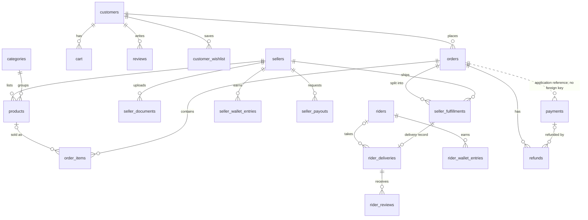

# Entity relationships

`payments.order_id` is intentionally not a foreign key. A delivery references one fulfillment through a unique, non-null `fulfillment_id`, so each fulfillment has at most one delivery record. Wallet and payout rows reference their owning seller or rider; the diagram omits non-FK reference IDs.