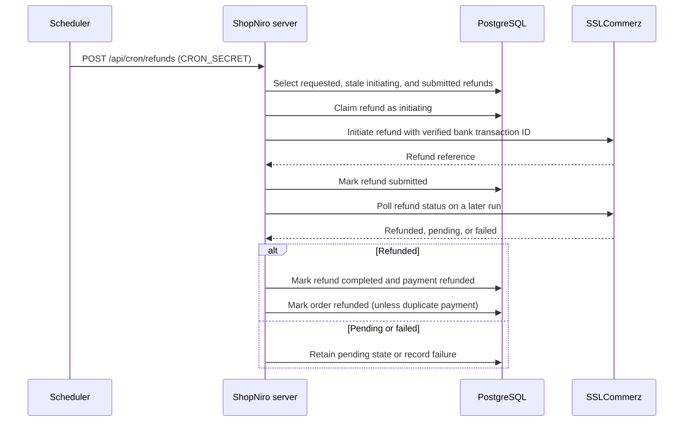

# Operational flows

## SSLCommerz payment

```mermaid
sequenceDiagram
    participant C as Customer
    participant S as ShopNiro server
    participant DB as PostgreSQL
    participant G as SSLCommerz
    C->>S: POST /api/orders
    S->>DB: Create order and items (online payment pending)
    C->>S: POST /api/payment/init {orderId, paymentMethod}
    S->>DB: Lock customer's order; reuse or create pending payment
    S->>S: Calculate amount from order subtotal + shipping fee
    S->>G: Create hosted payment session (after transaction)
    G-->>S: Hosted session URL
    S-->>C: Session details
    C->>G: Redirect browser to hosted checkout
    alt IPN or success callback
        G->>S: tran_id and val_id
        S->>G: Validate val_id
        G-->>S: Validation response
        S->>S: Verify status, amount, currency, and transaction
        S->>DB: Mark payment VALIDATED and order paid atomically
    else duplicate payment
        S->>DB: Queue duplicate payment refund
    end
```

Payment initialization uses server-owned order totals; client-supplied amounts are rejected. Both the authenticated validation route and SSLCommerz success/IPN callbacks use gateway validation before finalizing state.

## Refund queue



## Seller payout

```mermaid
sequenceDiagram
    participant Seller
    participant S as ShopNiro server
    participant DB as PostgreSQL
    participant Admin
    Seller->>S: POST /api/sellers/me/payouts {amount}
    S->>DB: Lock seller; check payout verification and available balance
    S->>DB: Create requested payout and reserve wallet amount
    S-->>Seller: 201 requested
    Admin->>S: GET /api/payouts
    S->>DB: List requested payouts
    S-->>Admin: Payout queue
    Admin->>S: PATCH /api/payouts/:id/pay {externalReference}
    S->>DB: Lock payout and mark paid with reference
    S-->>Admin: Paid
```

Seller payout requests require a verified payout account and sufficient available balance. Payout processing routes are admin-only; the external transfer is recorded with its reference.