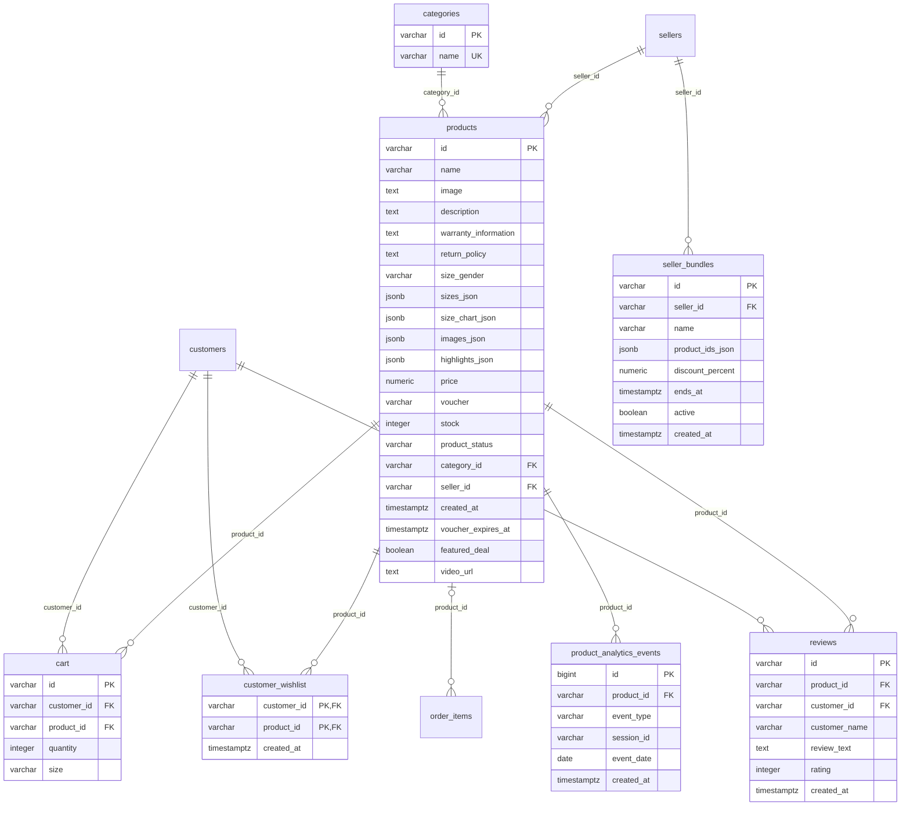
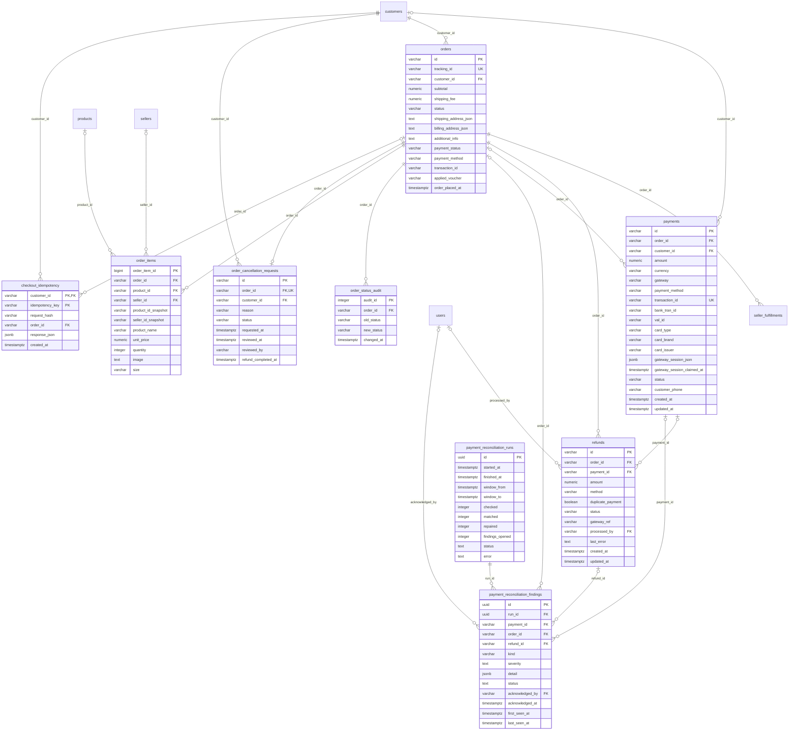
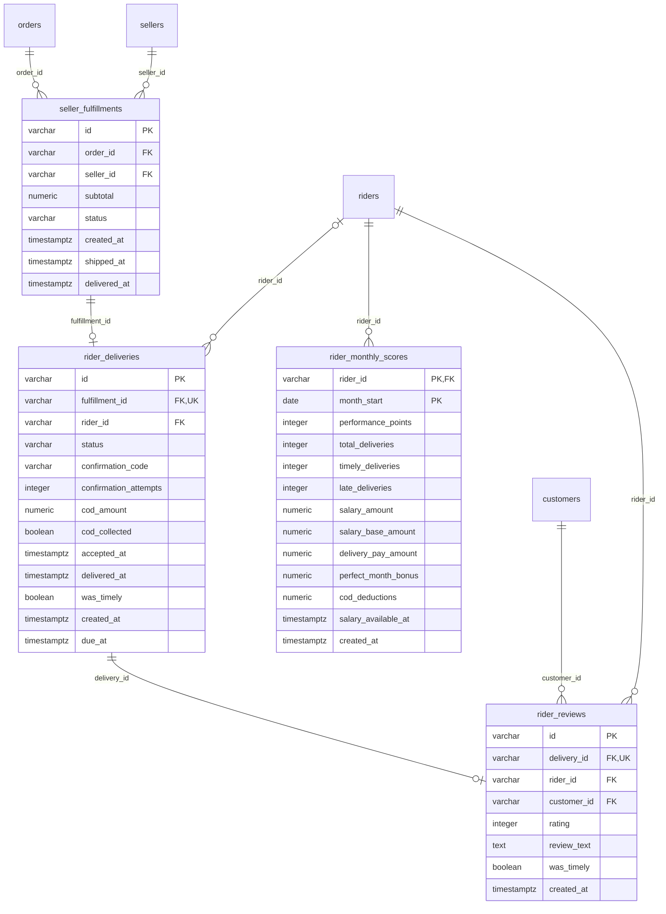
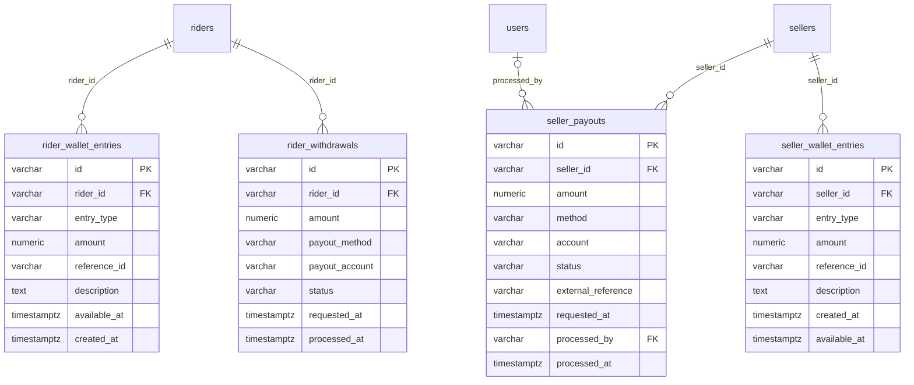
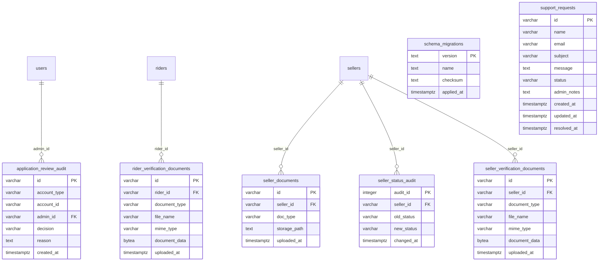

# Database schema

> Generated by `npm run docs:schema` from the migrated PostgreSQL schema; do not edit by hand. Re-run it after adding a migration.
> For the reasoning behind the design see [database-design.md](database-design.md); for a one-page overview see [erd.md](erd.md).

40 tables and 55 foreign keys, grouped into 6 domains. In each diagram a table that belongs to another domain appears as an empty box, so you can see where the groups connect.

Read the relationship lines like this: `||--o{` is "one to many", `|o--o{` is "optional one to many" (the foreign key may be empty), and `||--o|` is "one to at most one". `PK` marks a primary key, `FK` a foreign key and `UK` a column that is unique on its own. Not every reference between tables is a foreign key; where a column points at rows in more than one table (for example `seller_wallet_entries.reference_id`, which names a fulfilment or a payout depending on the entry type) no line is drawn.

| Domain | Tables |
| --- | --- |
| [Identity and access](#identity-and-access) | `users`, `customers`, `sellers`, `riders`, `admins`, `auth_sessions`, `oauth_identities`, `password_reset_tokens`, `customer_policy_consents` |
| [Catalogue and discovery](#catalogue-and-discovery) | `categories`, `products`, `seller_bundles`, `cart`, `customer_wishlist`, `reviews`, `product_analytics_events` |
| [Orders and payments](#orders-and-payments) | `orders`, `order_items`, `checkout_idempotency`, `payments`, `refunds`, `order_cancellation_requests`, `order_status_audit`, `payment_reconciliation_runs`, `payment_reconciliation_findings` |
| [Fulfilment and delivery](#fulfilment-and-delivery) | `seller_fulfillments`, `rider_deliveries`, `rider_reviews`, `rider_monthly_scores` |
| [Wallets and payouts](#wallets-and-payouts) | `seller_wallet_entries`, `seller_payouts`, `rider_wallet_entries`, `rider_withdrawals` |
| [Verification, support and operations](#verification-support-and-operations) | `seller_documents`, `seller_verification_documents`, `rider_verification_documents`, `application_review_audit`, `seller_status_audit`, `support_requests`, `schema_migrations` |

## Identity and access

Who can sign in, as what, and how their sessions and consents are recorded.

```mermaid
erDiagram
    users ||--o| admins : "id"
    users ||--o{ application_review_audit : "admin_id"
    users ||--o{ auth_sessions : "user_id"
    customers ||--o{ cart : "customer_id"
    customers ||--o{ checkout_idempotency : "customer_id"
    customers ||--o{ customer_policy_consents : "customer_id"
    customers ||--o{ customer_wishlist : "customer_id"
    users ||--o| customers : "id"
    users ||--o{ oauth_identities : "user_id"
    customers ||--o{ order_cancellation_requests : "customer_id"
    sellers |o--o{ order_items : "seller_id"
    customers ||--o{ orders : "customer_id"
    users ||--o| password_reset_tokens : "user_id"
    users |o--o{ payment_reconciliation_findings : "acknowledged_by"
    customers |o--o{ payments : "customer_id"
    sellers ||--o{ products : "seller_id"
    users |o--o{ refunds : "processed_by"
    customers ||--o{ reviews : "customer_id"
    riders |o--o{ rider_deliveries : "rider_id"
    riders ||--o{ rider_monthly_scores : "rider_id"
    customers ||--o{ rider_reviews : "customer_id"
    riders ||--o{ rider_reviews : "rider_id"
    riders ||--o{ rider_verification_documents : "rider_id"
    riders ||--o{ rider_wallet_entries : "rider_id"
    riders ||--o{ rider_withdrawals : "rider_id"
    users ||--o| riders : "id"
    sellers ||--o{ seller_bundles : "seller_id"
    sellers ||--o{ seller_documents : "seller_id"
    sellers ||--o{ seller_fulfillments : "seller_id"
    users |o--o{ seller_payouts : "processed_by"
    sellers ||--o{ seller_payouts : "seller_id"
    sellers ||--o{ seller_status_audit : "seller_id"
    sellers ||--o{ seller_verification_documents : "seller_id"
    sellers ||--o{ seller_wallet_entries : "seller_id"
    users ||--o| sellers : "id"
    admins {
        varchar id PK,FK
        varchar name
        varchar number
        varchar address_house_name
        varchar address_street
        varchar address_city
        varchar address_postal_code
        text address_additional_info
        timestamptz created_at
    }
    auth_sessions {
        varchar jti PK
        varchar user_id FK
        timestamptz expires_at
        timestamptz revoked_at
        timestamptz created_at
    }
    customer_policy_consents {
        varchar id PK
        varchar customer_id FK
        varchar policy_id
        varchar policy_version
        varchar consent_source
        timestamptz consented_at
    }
    customers {
        varchar id PK,FK
        varchar name
        varchar number
        varchar address_house_name
        varchar address_street
        varchar address_city
        varchar address_postal_code
        text address_additional_info
        float8 address_latitude
        float8 address_longitude
        timestamptz marketing_consent_at
        timestamptz welcome_offer_email_sent_at
        timestamptz created_at
        timestamptz account_deleted_at
    }
    oauth_identities {
        varchar provider PK
        varchar provider_user_id PK
        varchar user_id FK
        timestamptz created_at
    }
    password_reset_tokens {
        varchar user_id PK,FK
        varchar token_hash UK
        timestamptz expires_at
        timestamptz created_at
        timestamptz used_at
    }
    riders {
        varchar id PK,FK
        varchar name
        varchar number
        varchar status
        jsonb present_address_json
        jsonb permanent_address_json
        boolean has_cv
        varchar cv_file_name
        bytea cv_pdf
        text profile_image
        varchar profile_image_file_name
        jsonb experience_json
        jsonb previous_jobs_json
        jsonb education_json
        float8 current_latitude
        float8 current_longitude
        integer total_deliveries
        integer timely_deliveries
        integer late_deliveries
        integer performance_points
        numeric wallet_balance
        timestamptz created_at
        timestamptz updated_at
    }
    sellers {
        varchar id PK,FK
        varchar name
        varchar number
        text logo
        text description
        varchar status
        varchar address_house_name
        varchar address_street
        varchar address_city
        varchar address_postal_code
        text address_additional_info
        float8 address_latitude
        float8 address_longitude
        timestamptz created_at
        varchar business_registration_number
        varchar payout_method
        varchar payout_account
        boolean identity_verified
        boolean documents_reviewed
        boolean payout_verified
    }
    users {
        varchar id PK
        varchar username UK
        varchar password
        varchar email UK
        varchar role
        timestamptz created_at
    }
```

## Catalogue and discovery

What can be bought, what customers keep for later and what they say about it.

## Orders and payments

From a checkout to a paid, refunded or cancelled order, with the nightly reconciliation that checks it against the gateway.

## Fulfilment and delivery

An order is split per seller; each part is shipped and delivered by a rider.

## Wallets and payouts

Append-only ledger entries for what sellers and riders earn, and the payouts and withdrawals that settle them.

## Verification, support and operations

Documents and review trails for approving sellers and riders, customer support, and the migration history.

